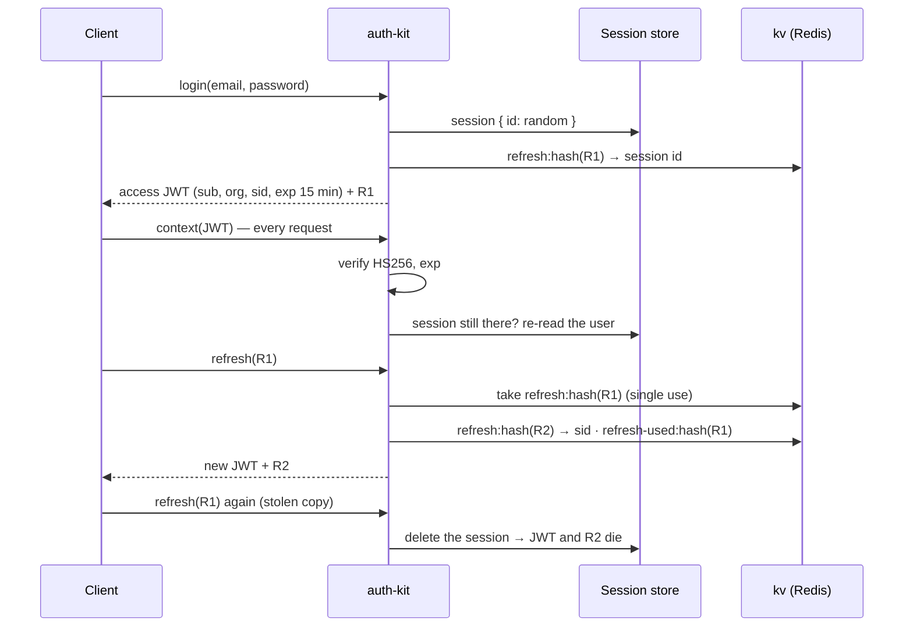

# auth-kit

**Authentication and permissions for the MGPL Diagnostics backend, as an internal API.**
There is no HTTP server here. Your backend (GraphQL resolvers, REST handlers, jobs) calls these functions.

 

## What it does

| | |
| --- | --- |
| **Passwords** | scrypt (N=2¹⁵), salted, self-describing hashes; weaker hashes upgraded on the next login; NIST-style policy (length, common passwords, repeated characters, no email) |
| **Login** | rate-limited per IP and per email; timing-safe (an unknown email costs the same as a wrong password); same email in several organisations → `ORG_REQUIRED`; audited |
| **Sessions** | opaque tokens, stored only as SHA-256; idle timeout that slides with use plus an absolute maximum age; list devices, revoke one, log out everywhere |
| **JWT mode** | short-lived HS256 access tokens plus single-use refresh tokens, rotated on every refresh; a refresh token used twice ends its session (theft); secret rotation; logout and revocation still apply at once |
| **Accounts** | disabling a user or changing roles applies on the very next request |
| **Passwords, again** | change (keeps this device, ends the others); reset (single-use, expiring token; ends every session); admin set |
| **Permissions** | `resource:action` with wildcards; roles per branch or organisation-wide; built-in lab roles plus each organisation's own |
| **Stores** | memory (tests, one server) or Redis (`/redis`, shared by all servers) |

## Use

```ts
import { createAuth, SYSTEM_ROLES } from "@mgpl-diagnostics/auth-kit";
import { redisKeyValueStore, redisRateLimiter, redisSessionStore } from "@mgpl-diagnostics/auth-kit/redis";

// db-kit's repositories satisfy the user / org / role / audit stores as they are
const auth = createAuth({
  users: db.repos.users,
  orgs: db.repos.orgs,
  roles: db.repos.roles,
  audit: db.repos.audit,
  sessions: redisSessionStore(redis),
  kv: redisKeyValueStore(redis),
  limiter: redisRateLimiter(redis, { limit: 10, windowMs: 15 * 60_000 }),
});

const { token, user } = await auth.login({ email, password, ip, userAgent });

// per request, e.g. in the GraphQL context
const { viewer, can, branchesFor } = await auth.context(bearerToken);
can("invoice:create", branchId);   // true / false
branchesFor("booking:read");        // "all" or ["branch-id", …]
```

When you create an organisation, seed the roles: `seedOrganization(repos, { …, roles: SYSTEM_ROLES })`
(db-kit). To create a user, call `auth.hashNewPassword(password, { email })`, which checks the policy
and then hashes.

## JWT mode (access + refresh tokens)

Pass `jwt` and login returns a short-lived **access token** (an HS256 JWT, sent as `Authorization: Bearer`)
and a long-lived **refresh token** (opaque, single-use). The client trades the refresh token for a new pair
when the access token expires.

```ts
const auth = createAuth({ …, kv: redisKeyValueStore(redis), jwt: { secret: process.env.JWT_SECRET!, issuer: "mgpl-api", accessTtlMs: 15 * 60_000 } });

const { token: accessToken, refreshToken } = await auth.login({ email, password });
const ctx = await auth.context(accessToken);                    // same context as before
const next = await auth.refresh({ refreshToken });              // { accessToken, refreshToken (new), … }
```



- **Revocation stays instant.** The JWT carries the session id, and every request checks that the session
  still exists and re-reads the user (rule 3). The signature alone is enough only for
  `verifyAccessToken(token)`, which workers and other services can use without storage.
- **Refresh tokens rotate.** Each is single-use and stored only as a hash. A spent token presented again
  within `reuseGraceMs` (default 15 s, two tabs refreshing at once) is just refused; later, it ends the
  session.
- **Lifetimes.** Access: `accessTtlMs` (default 15 min). Refresh: the session's idle window, slid by each
  refresh, and never past the absolute maximum age.
- **Secrets.** At least 32 characters. Pass `secret: [newSecret, oldSecret]` to rotate: the first signs and
  all verify.
- `logout` accepts the access token (even expired), the refresh token, or an opaque session token.

### Device binding

Clients can send security signals with `login` and `refresh` (`device: DeviceSignals`). They are cleaned
(`cleanDeviceSignals`: ids 8–128 safe characters, at most 20 short `info` values) and stored on the session.

| Signal | What it is | On refresh |
| --- | --- | --- |
| `deviceId` | random id the client keeps per browser profile or app install | must match the login's, else (`deviceBinding: "enforce"`, default) `INVALID_TOKEN` and the session ends; `"flag"` only audits; `"off"` ignores |
| `fingerprint` | client-side hash of stable device attributes | a change is audited (`auth.fingerprint_changed`); browsers update, so it never blocks |
| `clientSessionId` | random id per tab or app run | recorded (latest) |
| `info` | platform, language, timezone, screen… | recorded (latest) |

A session that signed in without a `deviceId` is bound by the first refresh that sends one.
`sessionsOf` returns `device`, so a "your devices" page can show it.

**TLS fingerprint.** The server can also pass `tlsFingerprint` (JA4 or JA3) to `login` and `refresh`. It
is computed by whatever terminates TLS, so it never comes from the client: read it with security-kit's
`readTlsFingerprint` (a header set by a trusted proxy). Only its SHA-256 (`hashTlsFingerprint`) is stored,
as `Session.tlsFingerprintHash`. On refresh a different one is audited (`auth.tls_fingerprint_changed`,
with both hashes) and the latest is kept; it never blocks, because browser updates and TLS-inspecting
networks change it. A refresh without one keeps the stored hash, and `auth.device_mismatch` records
`tls: "same" | "changed" | null`, which helps tell a copied token from a cleared browser.

## API

| Call | Returns / throws |
| --- | --- |
| `login({ email, password, orgCode?, ip?, userAgent?, device?, tlsFingerprint? })` | `{ token, expiresAt, user }`, plus `refreshToken, refreshExpiresAt` in JWT mode (`token` is then the access JWT) · `INVALID_CREDENTIALS` `ACCOUNT_DISABLED` `INVITE_PENDING` `ORG_REQUIRED` `RATE_LIMITED` |
| `refresh({ refreshToken, ip?, userAgent?, device?, tlsFingerprint? })` | JWT mode: `{ accessToken, accessExpiresAt, refreshToken, refreshExpiresAt, user }` · `INVALID_TOKEN` (also: another device) |
| `verifyAccessToken(token)` | JWT mode: claims `{ sub, org, sid, iat, exp }` or null, no storage read |
| `authenticate(token)` | `Viewer \| null` (slides the idle window) |
| `context(token)` | `{ viewer, can, branchesFor, permissions }` (anonymous when the token is missing or invalid) |
| `require(token, permission?, branchId?)` | `Viewer` · `UNAUTHENTICATED` `FORBIDDEN` |
| `logout(token)` · `logoutAll(userId, keepToken?)` | |
| `sessionsOf(userId)` · `revokeSession(userId, sessionId)` | devices; revoke one |
| `changePassword({ userId, currentPassword, newPassword, currentToken? })` | `INVALID_CREDENTIALS` `WEAK_PASSWORD` |
| `requestPasswordReset({ email, orgCode?, ip? })` | `{ token, expiresAt, user } \| null`. Deliver the token yourself; reply identically when it is null |
| `resetPassword({ token, newPassword })` | `INVALID_TOKEN` `WEAK_PASSWORD` |
| `setPassword(userId, newPassword, actorId?)` · `hashNewPassword(pw, user)` | admin tools |
| `invalidateRoles(orgId?)` | call after editing roles |

Also exported:
- `hashPassword`, `verifyPassword`, `needsRehash`, `assertPasswordPolicy`;
- `randomToken`, `hashToken`;
- `jwtSigner`, `looksLikeJwt` (HS256 sign/verify on node:crypto);
- `cleanDeviceSignals` and the `DeviceSignals` type; `hashTlsFingerprint`;
- `PERMISSIONS`, `SYSTEM_ROLES`;
- `can`, `branchesFor`, `permissionsOf`, `roleMap`.

Every failure is an `AuthError` with a stable `code`, an HTTP-style `statusCode`, and `details.retryAfterMs`
where it applies.

## Built-in roles

`owner` (everything) · `admin` · `branch_manager` · `front_desk` · `phlebotomist` · `technician` ·
`pathologist` · `accountant` (including the books: `accounts:*`) · `doctor` (referring; read only).

## Not here (by design)

- **HTTP / GraphQL endpoints.** The backend exposes `login`, `logout`, `me` and the rest as GraphQL
  mutations and queries, and calls this API.
- **Browser code.** A client package comes later.

## Licence

All rights reserved. See [LICENSE](LICENSE).
